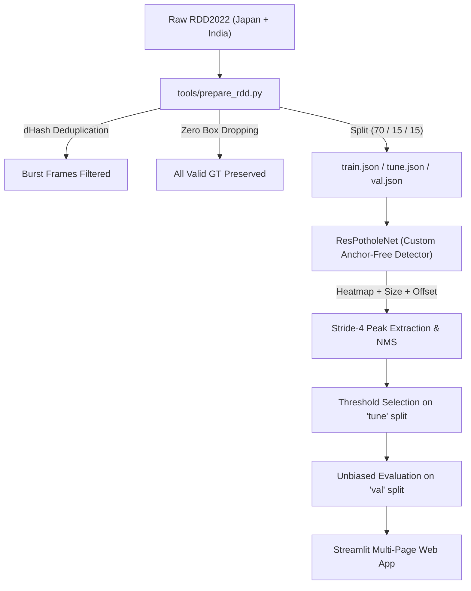

# Road Damage Detection (Scratch Implementation)

An end-to-end computer vision pipeline and custom anchor-free deep neural network designed from scratch for road damage and pothole detection. Built with pure PyTorch, OpenCV, NumPy, and Streamlit—without using third-party object detection frameworks, pretrained backbones, or transfer learning.

[](https://www.python.org/)
[](https://pytorch.org/)
[]()
[-orange.svg)](https://github.com/sekilab/RoadDamageDetector)
[](https://colab.research.google.com/github/Naitikjha/road-damage-detection/blob/main/notebooks/colab_train.ipynb)
[]()

---

## 📌 Project Highlights & Core Philosophy

* **100% From-Scratch Architecture**: Custom anchor-free model (`ResPotholeNet`) featuring residual stages with Squeeze-and-Excitation (SE) attention, Spatial Pyramid Pooling - Fast (SPPF), a multi-scale Feature Pyramid neck, and a high-resolution stride-4 center-heatmap head.
* **No Pretrained Weights**: Every weight is initialized from scratch and trained directly on road imagery. No ImageNet or COCO checkpoints are used.
* **Leakage-Free Scientific Data Pipeline**: 
  * Near-duplicate dashcam burst elimination via 64-bit Difference Hashing (`dHash`).
  * 3-Way partitioned split: **Train (70%)**, **Tune (15%)**, and **Val (15%)**. Confidence thresholds and NMS parameters are selected strictly on the `tune` split—never on `val`.
  * Background image capping ($\le 10\%$) to combat class sparsity.
  * Zero small-box filtering during preprocessing to maximize coverage on distant or small potholes.
* **Multi-Page Inspection App**: Streamlit web application supporting image inference, video tracking with custom Kalman SORT, and Grad-CAM interpretability.

---

## 🏗️ Project Architecture & Workflow



---

## 📊 Dataset: RDD2022 (Japan & India)

This project utilizes the **Road Damage Dataset 2022 (RDD2022)** released by Sekilab.

* **Reference Citations**:
  > Arya, D., Maeda, H., Ghosh, S. K., Toshniwal, D., Mraz, A., Kashiyama, T., & Sekimoto, Y. (2022). *Crowdsensing-based Road Damage Detection: An Extended Dataset and Transferability Analysis*. arXiv:2208.14444.
  > 
  > Maeda, H., Sekimoto, Y., Seto, T., Kashiyama, T., & Omata, H. (2018). *Road Damage Detection Using Deep Neural Networks with Smartphone Images*. Computer-Aided Civil and Infrastructure Engineering.
* **RDD2022 Public Test Set Notice**: The official RDD2022 competition only provides public ground truth annotations for the **training sets** of each country. The test sets do not contain public labels. Consequently, this repository establishes a rigorous local train/tune/val partition with near-duplicate separation and block-based grouping (50 frames per block) to ensure valid, reproducible evaluation.
* **Target Classes**:
  * `D40`: **Pothole** (Default single-class focus for road safety)
  * `D00`: Longitudinal Crack (Optional via `configs/all_classes.yaml`)
  * `D10`: Transverse Crack (Optional via `configs/all_classes.yaml`)
  * `D20`: Alligator Fatigue Crack (Optional via `configs/all_classes.yaml`)

For full details regarding dataset schema, box area distributions, and deduplication logic, refer to **[`DATA_CARD.md`](DATA_CARD.md)**.

---

## 📂 Repository Structure

```
ROAD-DAMAGE/
├── configs/
│   ├── pothole_only.yaml       # Default configuration (D40 Pothole, 512x512, seed 42)
│   └── all_classes.yaml        # Multi-class configuration (D00, D10, D20, D40)
├── src/
│   ├── data/
│   │   ├── __init__.py
│   │   ├── phash.py            # 64-bit dHash and Hamming distance implementation
│   │   └── dataset.py          # PyTorch Dataset with aspect-ratio letterboxing
│   └── __init__.py
├── tools/
│   ├── prepare_rdd.py          # PascalVOC XML parser, deduplicator, and 3-way splitter
│   ├── show_samples.py         # Visualizer rendering 24-image ground truth inspection grid
│   └── create_dummy_rdd.py     # Synthetic RDD2022 generator for quick test verification
├── tests/
│   └── test_prepare_rdd.py     # Unit tests for preprocessing, dHash, and dataset loading
├── outputs/
│   └── sample_inspections.jpg  # Generated 24-sample visual inspection grid
├── DATA_CARD.md                # Comprehensive data specification and statistics
├── requirements.txt            # Minimal permitted dependencies
└── README.md
```

---

## ⚡ Quickstart & Reproducibility

### 1. Installation
Clone the repository and install dependencies in your environment:
```bash
git clone https://github.com/Naitikjha/road-damage-detection.git
cd road-damage-detection
pip install -r requirements.txt
```

### 2. Run Unit Tests
Verify all preprocessing components, coordinate clipping, letterboxing geometry, and PyTorch dataloading:
```bash
python -m pytest -v tests/test_prepare_rdd.py
```

### 3. Data Preparation
To prepare the dataset from downloaded RDD2022 Japan + India archives:
1. Place the extracted archives into `data/raw/RDD2022/` (`Japan/train/...` and `India/train/...`).
2. Run data preparation:
   ```bash
   python tools/prepare_rdd.py --config configs/pothole_only.yaml
   ```
*(Optional test run: To run the pipeline on synthetic verification data, run `python tools/create_dummy_rdd.py` first).*

### 4. Inspect Sample Ground Truths
Generate a consolidated high-resolution inspection grid with bounding boxes and dimensions:
```bash
python tools/show_samples.py --manifest data/processed/pothole_only/train.json --num-samples 24 --output outputs/sample_inspections.jpg
```

---

## 🔍 Development Roadmap

- [x] **Phase 1: Data Pipeline & Quality Assurance**
  - [x] PascalVOC XML to modular JSON manifest ingestion.
  * [x] dHash near-duplicate frame detection across temporal dashcam bursts.
  * [x] 10% background-only image capping.
  * [x] Three-way deterministic split (`train`, `tune`, `val`) with fixed seed `42`.
  * [x] Aspect-ratio-preserving letterbox resizing in PyTorch Dataset.
  * [x] Comprehensive unit test suite (`test_prepare_rdd.py`).
- [ ] **Phase 2: Custom Detector Architecture & Losses**
  * Anchor-free `ResPotholeNet` (strided stem, SE-attention residual blocks, SPPF).
  * FPN neck with stride-4 CenterNet-style prediction head.
  * Gaussian target heatmap encoder and sub-pixel box decoder.
  * Modified focal loss + GIoU bounding box loss.
  * 16-image overfit unit test.
- [ ] **Phase 3: Training & Checkpointing Engine**
  * AdamW optimizer, warmup + cosine learning rate schedule.
  * Mixed precision (AMP), gradient clipping, and checkpoint resumption.
- [ ] **Phase 4: Rigorous Evaluation & Error Analysis**
  * PR curves, F1-vs-confidence curve, size breakdown (small/medium/large).
  * Separate threshold selection on `tune` split.
  * Automated missed-box audit to `failure_gallery/`.
  * Evaluation on real-world gravel road video with domain-gap analysis.
- [ ] **Phase 5: Multi-Page Streamlit Application**
  * Image, video (with Kalman SORT tracker), and webcam inference.
  * Grad-CAM visual interpretability on the backbone's final stage.

---

## ⚠️ Known Limitations & Domain Caveats

1. **Training from Scratch vs Transfer Learning**: Training completely from random initialization requires adequate data diversity and training epochs compared to models initialized with ImageNet features.
2. **Dashcam vs Rural Ground Perspective Gap**: RDD2022 images are acquired through car windshields on paved roads in Japan and India. Models trained strictly on dashcam angles may experience domain shift when deployed on unpaved gravel roads with standing water or handheld camera angles.
3. **No Public Test Labels**: All benchmark numbers are strictly derived from the local partition, preventing any risk of unverified competition test set leakage.

---

## 📜 Acknowledgements & Inspiration

* **Dataset**: Sekilab [RDD2022](https://github.com/sekilab/RoadDamageDetector) (Japan and India subsets).
* **Workflow Inspiration**: Structural inspiration and application workflow referenced from [oracl4/RoadDamageDetection](https://github.com/oracl4/RoadDamageDetection). All models, loss functions, target encodings, decoding routines, and preprocessing code in this repository were written completely from scratch.
